# SmashCart 🏸

A full-stack badminton e-commerce store: customers browse rackets, shuttlecocks, shoes and bags, get automatic discounts, order with cash on delivery, and chat with an AI shopping assistant. The owner manages everything from an admin panel.

**Live site:** https://smash-cart.vercel.app
**API:** https://smashcart-api-ude6.onrender.com

> The API runs on a free Render plan, so the very first request after a quiet period can take up to a minute.

## Screenshots

### Shop

| Home | Products |
| --- | --- |
| 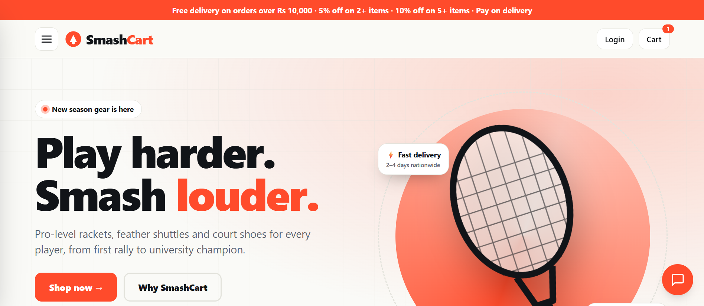 | 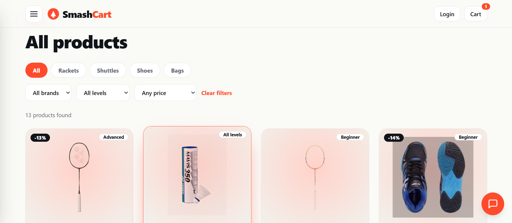 |

| Cart with discount banner | Cart with free gift picker |
| --- | --- |
| 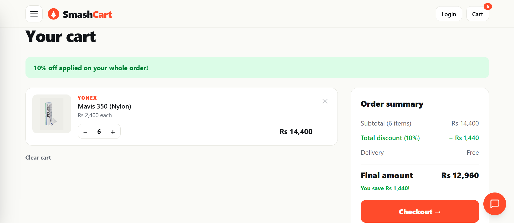 | 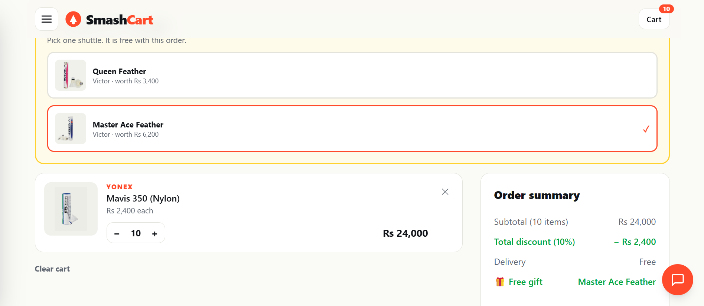 |

| Checkout | Order confirmation |
| --- | --- |
| 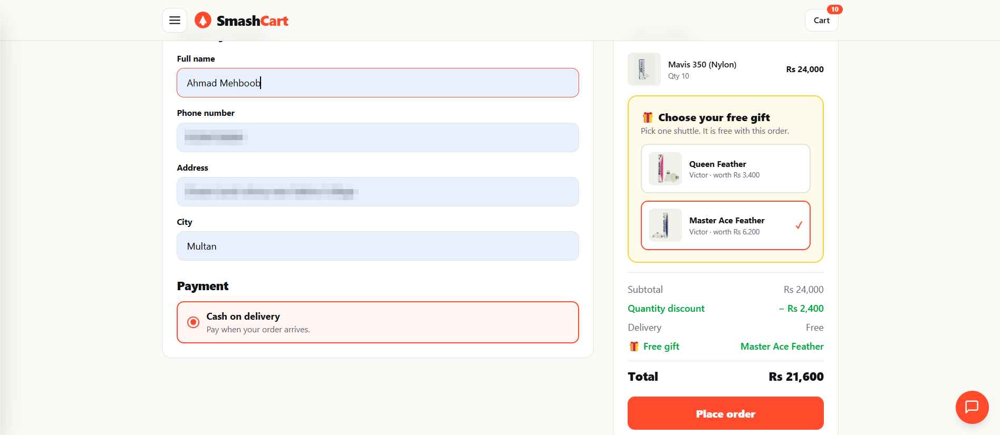 | 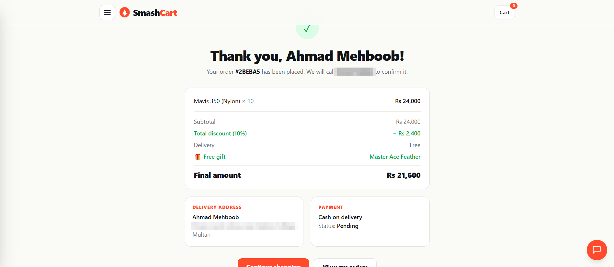 |

### AI assistant

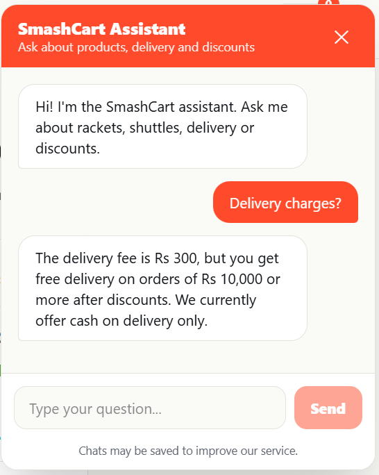

### Admin panel

| Dashboard | Products |
| --- | --- |
| 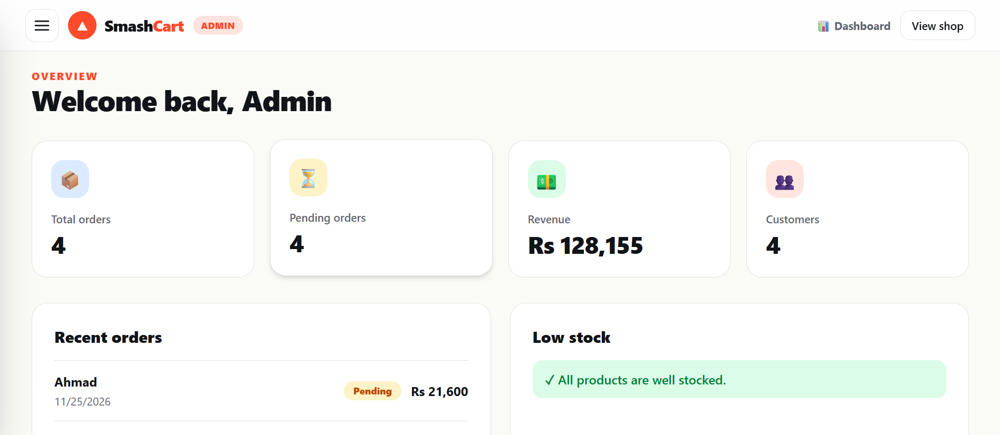 | 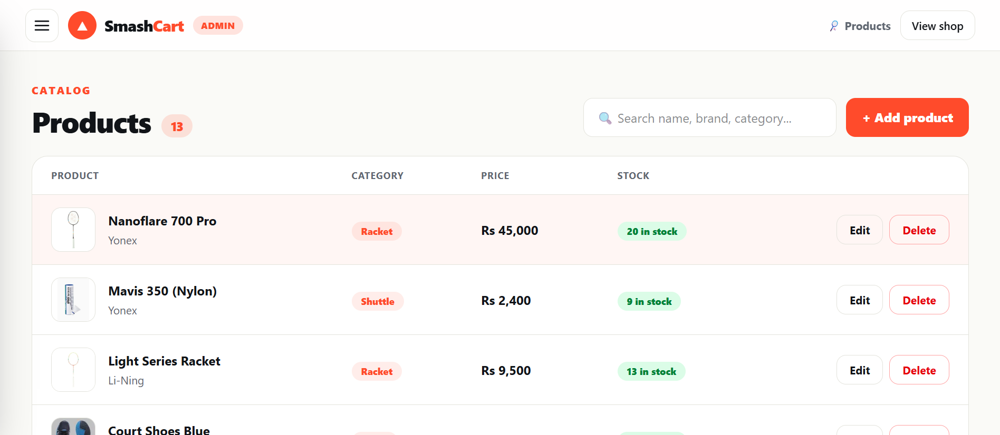 |

| Orders | Customers |
| --- | --- |
| 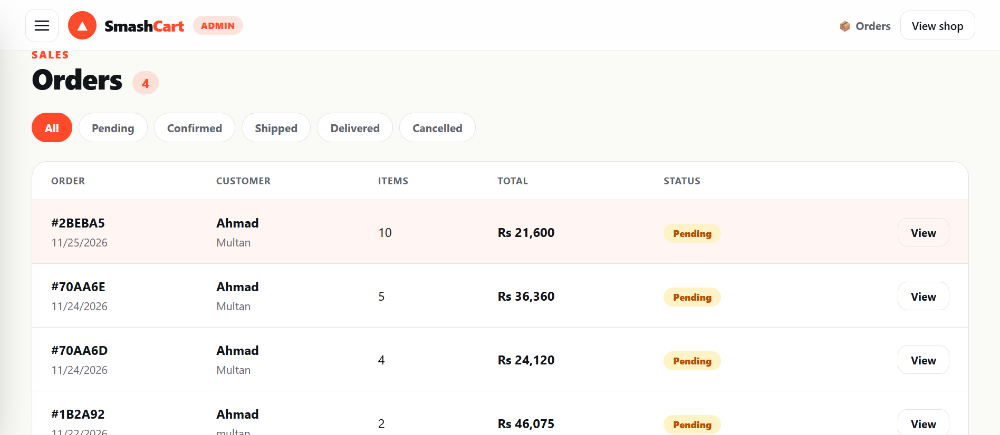 | 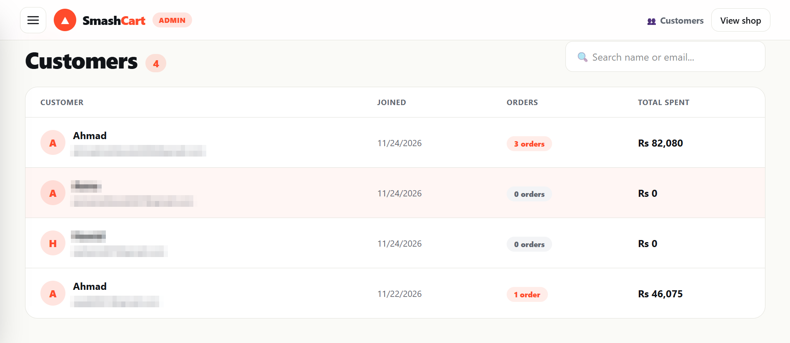 |

| Stock | Settings |
| --- | --- |
| 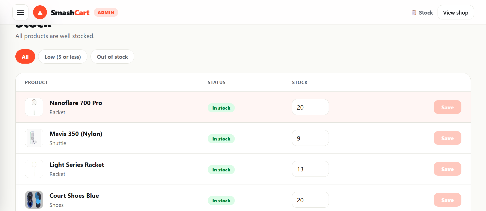 | 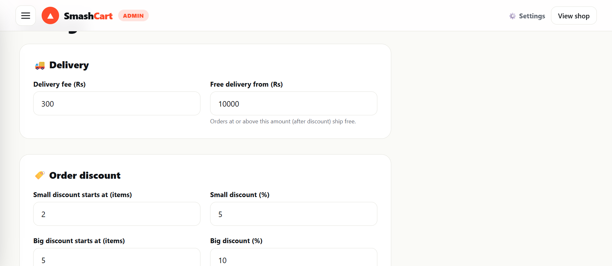 |

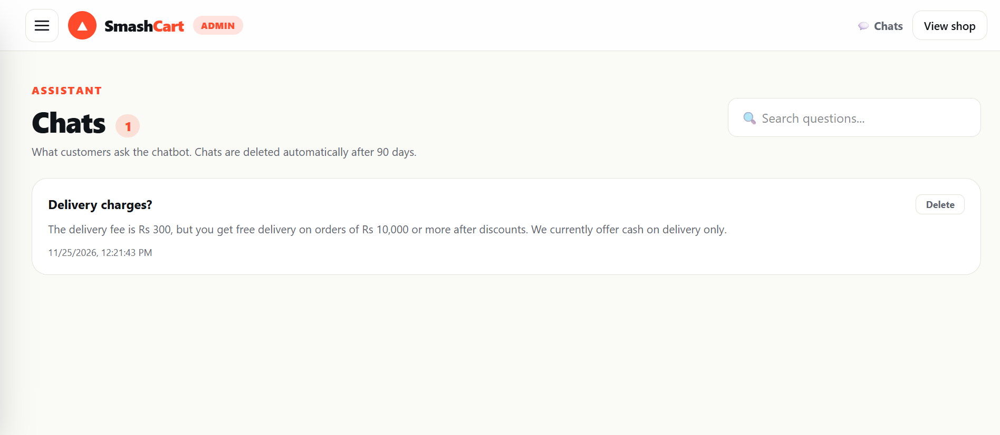

## Features

### Customers
- Product catalog with category filters, product detail pages and live stock ("Out of stock" when it runs out)
- Sign up, log in (with show/hide password), forgot-password email with a reset link, profile page
- Cart that is saved in the browser, with automatic discounts:
  - quantity discounts (percentages and item counts are set by the admin)
  - **first-order offer:** 30% off for 1-2 items, 40% for 3 items, 60% for 4 or more
  - **free gift:** returning customers who order Rs 20,000 or more choose a free shuttle (Rs 3,000-8,000)
- Cash-on-delivery checkout, order history, order details, cancel while still pending
- AI shopping assistant (Google Gemini) that answers from the live product list, prices and shop rules; the chat button can be dragged to either side of the screen
- Contact form that is saved to the database and emailed to the owner
- Sidebar navigation and a top offer bar that always shows the current settings

### Admin panel
- Dashboard with sales and order statistics
- Product management: add, edit, delete, with photo upload to Cloudinary
- Orders: filter by status and move them through pending → confirmed → shipped → delivered, or cancel (stock, including the gift, goes back automatically)
- Customers list with order counts and total spent
- Stock page for quick stock edits
- Settings: delivery fee, free-delivery amount and discount tiers; changing them updates the whole site instantly
- Chats: the questions customers asked the assistant, with the most common ones

## Tech stack

| Part | Technology |
| --- | --- |
| Frontend | Next.js 16 (App Router), React, Tailwind CSS v4 |
| Backend | Node.js, Express 5 |
| Database | MongoDB Atlas with Mongoose |
| Auth | JWT, bcryptjs, role checks (customer / admin) |
| Email | Brevo (password reset), Web3Forms (contact form) |
| Images | Cloudinary |
| AI | Google Gemini API |
| Hosting | Vercel (frontend), Render (API) |

## How it is built

- **Prices are never trusted from the browser.** The server reads every price from the database and calculates discounts, delivery and gifts itself.
- **Stock is updated atomically** (only if enough is left), and goes back when an order is cancelled.
- **Admin routes are protected on the server** with a token and role check, not just hidden in the interface.
- **Rate limiting** protects the contact form and the chatbot.
- **Secrets stay on the server.** Only public values start with `NEXT_PUBLIC_`.

## Run it locally

You need Node.js 20 or newer and a MongoDB database (local or Atlas).

**1. Start the API** (the `smashcart-api` folder, in the [API repository](https://github.com/opahmad759-cloud/New-folder-2-))

```bash
cd smashcart-api
npm install
npm start
```

Create `smashcart-api/.env`:

```
MONGO_URI=your-mongodb-connection-string
JWT_SECRET=a-long-random-string
CLIENT_URL=http://localhost:3000
ADMIN_EMAIL=you@example.com
ADMIN_PASSWORD=choose-a-strong-password
BREVO_API_KEY=...
MAIL_FROM=your-verified-sender@example.com
GEMINI_API_KEY=...
GEMINI_MODEL=gemini-3.5-flash-lite
CLOUDINARY_CLOUD_NAME=...
CLOUDINARY_API_KEY=...
CLOUDINARY_API_SECRET=...
```

Then add the sample products and your admin account (run `seed.js` only on an empty database, because it deletes existing products):

```bash
node seed.js
node createAdmin.js
```

**2. Start the website** (this repository)

```bash
npm install
npm run dev
```

Create `.env.local`:
